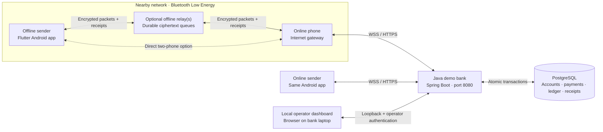
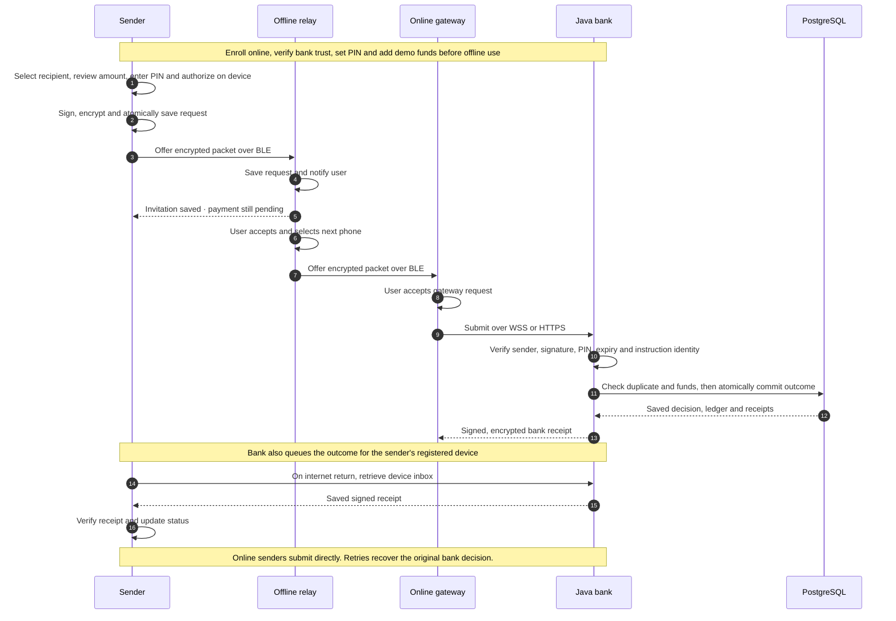

> **Campus development branch:** the app now opens a Payments/Campus chooser. See [Campus architecture, provisioning and validation](docs/CAMPUS.md) for the pilot setup and current limits. Existing installer APKs predate this branch.

# BeyondNet

Campus branch: [PSIT Kanpur server, independent tunnel, credentials and QR setup](docs/PSIT_CAMPUS.md). Campus update: 1.5.1 (build 21); see the guide for APK build status and physical acceptance requirements.

**Initiate payments offline. Carry encrypted requests through nearby phones. Settle when a gateway reaches the bank.**

BeyondNet is an Android payment proof of concept for environments with unreliable internet access. An offline phone sends a signed, encrypted payment request through a chain of enrolled Bluetooth devices. A phone with internet submits it to the Java demo bank, which records the outcome in PostgreSQL and returns a signed receipt through the available network.

| Mobile release | Bank release | Supported platform | Payment environment |
| --- | --- | --- | --- |
| **1.4.5 · build 19** | **1.3.3** | **Android 10+** | **Simulated INR** |

> BeyondNet uses demo funds and has no real UPI or banking integration. Payment initiation can happen offline; final settlement requires an internet-connected gateway to reach the bank.

**[Download Android 1.4.5](https://raw.githubusercontent.com/Shikharyadav25/BeyondNet/v1.4.5/installers/BeyondNet-Android-1.4.5.apk)** · [Release notes](docs/RELEASE_1.4.5.md) · [APK checksums](installers/SHA256SUMS.txt) · [Versioned source](https://github.com/Shikharyadav25/BeyondNet/tree/v1.4.5)

**131 app tests passed on 28 October 2026.** PIN setup now updates when the bank reconnects and offers a connection retry on the form. The unchanged bank retains its 46 Java/6 Python test baseline and the earlier payment/receipt fixes. Physical Bluetooth acceptance for this APK is still outstanding; automated radio simulations do not establish real-device delivery.

[Get started](#getting-started) · [Verified results](#verified-release-results) · [Architecture](#architecture) · [Features](#features) · [Tech stack](#tech-stack) · [Security](#security-and-payment-safety) · [Documentation](#documentation)

## Vision

Enable people in areas with poor connectivity to initiate payments through participating nearby devices. The network stores and carries encrypted requests across intermittent connections, while the bank remains the authority for balances, settlement and receipts.

The same app supports **Personal** and **Merchant** accounts. Relaying is an optional capability on either account type; an online relay automatically becomes a gateway when it can reach the bank.

## Architecture



- **Discovered topology:** two phones work without an intermediate relay; additional offline phones can form a chain. Honest peers enforce a four-hop forwarding limit; routing hints are not cryptographic proof of a malicious relay's actual hop count.
- **Ciphertext forwarding:** payment instructions and the demo PIN are encrypted for the bank. Relaying does not authorize a debit.
- **Internet-only bank:** the bank never joins Bluetooth and need not be near the phones. The bank runs on a laptop or server with local or hosted PostgreSQL.
- **Receipt recovery:** the bank saves a signed outcome for the sender's registered device. When that phone regains internet, it receives the outcome through WebSocket or fetches it through HTTPS, without needing the relay chain to remain intact.

### Payment flow



The authorization window is **10 minutes**, not a processing delay. Reachable requests are submitted immediately. A transport acknowledgment means a device stored the packet; only a verified bank receipt establishes the outcome. If the deadline passes without a receipt, the original request remains available for reconciliation. An already committed payment is not cancelled by a late receipt.

## Features

| Area | Implemented capabilities |
| --- | --- |
| Accounts | Personal/Merchant signup and sign-in, device enrollment, zero starting balance, idempotent demo funding |
| Bank setup | Scan a QR or select its image from the gallery to import the HTTPS URL and trust fingerprint |
| Payments | Recipient ID or signed identity QR, amount review, six-digit demo PIN and native screen-lock/biometric authorization |
| Connectivity | Direct online submission, bank reachability checks, offline guidance and explicit connection to a verified nearby peer |
| Nearby delivery | BLE store-and-forward, durable queues, custody acknowledgments, loop avoidance, shorter-route repair, bounded fanout and retry backoff |
| Background relay | Opt-in Android foreground service with a visible notification; forwarding can continue with the app screen closed or phone locked |
| Receipts | Bank-signed encrypted outcomes, live WebSocket delivery, HTTPS recovery, persisted inbox cursors and alternate return routes |
| Settlement | Funds preflight, unresolved-payment reservations, atomic debit/credit entries, duplicate recovery and bank-enforced balance checks |
| Operator console | Local authenticated overview, payment decisions, ledger, enrollment QR and labelled software rehearsal |

### Latest release: 1.4.5

The Payment PIN page now updates when bank connectivity changes, probes the connection on opening, and provides **Check bank connection** without leaving the form. Android connectivity hints cannot indefinitely block a bank probe. Form validation and specific save errors make recovery clear. Install **1.4.5 over the existing app**; no further bank change is needed when already running the 1.4.4 backend. See [PIN setup recovery and acceptance steps](docs/RELEASE_1.4.5.md).

### Included review fixes: 1.4.4

Transient bank database failures now remain retryable. Bank/phone routing validation agrees, malformed inbox receipts cannot block later valid entries, and actual storage failures keep the cursor available for retry. Persistent mailbox ownership prevents a different payment from overwriting receipt delivery, even after expiring delivery rows are cleaned up. Newly generated/refreshed recipient receipts omit the sender's detailed PIN failure. Authorization parsing, login work and rate-limit cleanup are hardened without replacing deployed cryptographic bytes or keys.

Install **1.4.4 over the existing app** and rebuild/restart the matching bank. Startup adds mailbox ownership records without deleting accounts, balances or history. See [release validation](docs/RELEASE_1.4.4.md) and the [supplied review assessment](docs/REVIEW_2026-10-28.md) for applied changes, deferred design work and obsolete findings.

### Included Nearby switch fix: 1.4.3

Bluetooth discovery, advertising, service setup and cleanup now have deadlines. A missing Android callback returns an actionable error and releases the relay switch. Both Home and Nearby show starting, stopping, on, off or paused status. Failed background startup stays paused until an explicit retry or Bluetooth/permission readiness changes, and stopping is serialized with background restoration so a late start cannot undo it.

Install **1.4.3 over the existing app** to preserve enrollment keys and pending payments. No bank update is needed when already running the 1.4.2 backend. See [Nearby switch fix and acceptance steps](docs/RELEASE_1.4.3.md).

### Included audit fixes: 1.4.2

This payment-only release fixes the audited receipt-recovery, relay-capacity and peer-response bugs. A saved paid or rejected decision can be delivered again after its original receipt expires, with no second debit or changed financial outcome. Expired invitations stop consuming capacity. Nearby replies are checked against the selected peer, authenticated inventory and requested packet.

Signup now explains connection failures, stops its progress indicator on error and offers sign-in to safely finish partially completed enrollment. Existing account details and device keys are retained. Independent integration cleanup uses the Python PostgreSQL driver on supported host architectures.

Install the update **over the existing app** on every participating phone; do not uninstall. Version code 16 upgrades the earlier 1.3.6, 1.4.0 and 1.4.1 builds. **Restart the bank with this release's backend** to enable refreshed receipt delivery. The app ID, signing identity and payment wire format remain compatible. The bank URL and fingerprint need not change.

See [release validation and acceptance steps](docs/RELEASE_1.4.2.md) and the [security roadmap](docs/SECURITY_ROADMAP.md).

## Verified release results

| Check | Result | What it exercises |
| --- | --- | --- |
| Flutter application tests | **131 passed · 28 Oct** | Accounts, payments, simulated offline routing, Bluetooth startup, receipt recovery, bank retry and PIN-page reconnection |
| Java bank tests | **46 passed · 1.4.4 baseline** | Settlement, database fault recovery, route validation, mailbox ownership, PIN checks, rejection privacy and receipt refresh |
| Android native tests | **20 passed · 27 Oct baseline** | Service lifecycle, BLE session APIs and SQLite startup using Robolectric |
| Independent Python tests | **6 passed · 1.4.4 baseline** | HTTP/WebSocket behavior, cross-language cryptography, supplementary-key ordering and legacy migration |
| Flutter static analysis | **No issues** | Application and test source checks |
| Release APK build | **Passed** | Version 1.4.5, build code 19, Android 10+, existing signing identity verified |

Tests use temporary identities and a separate PostgreSQL instance. The live integration tests exercise the Dart app against the Java bank; Bluetooth radio behavior is simulated. No new physical two-phone payment or on-device upgrade was observed for this release.

Bank/native source is unchanged in 1.4.5; baseline results above belong to their earlier validations. The current full Flutter suite includes a real Dart-to-Java bank integration check on an isolated database. Detailed scope and the phone acceptance checklist are in [1.4.5 release validation](docs/RELEASE_1.4.5.md). Earlier audit evidence remains in [1.4.2 validation results](docs/releases/1.4.2-validation.json).

## Tech stack

| Layer | Technologies | Responsibility |
| --- | --- | --- |
| Mobile UI | Flutter 3.44+ · Dart 3.12+ · Material 3 | Android account, payment and connectivity experience |
| Android runtime | Native foreground service · retained Flutter engine | Background relay lifecycle and notification |
| Nearby transport | Bluetooth LE GATT · `bluetooth_low_energy` | Central/peripheral communication between enrolled phones |
| Online transport | Secure WebSocket · HTTPS | Submission, live receipts and recovery |
| Phone persistence | SQLite/`sqflite` · `flutter_secure_storage` | Durable queues/history and OS-protected secret storage |
| Authorization and QR | `local_auth` · `mobile_scanner` · `qr_flutter` · `image_picker` | Device authentication, QR scanning and image import |
| Cryptography | X25519 · HKDF-SHA256 · AES-256-GCM · Ed25519 | Hybrid encryption and signed authorizations/receipts |
| Bank service | Java 21+ · Spring Boot 4.1.1 · Maven | Enrollment, authentication, financial validation and APIs |
| Bank database | PostgreSQL 17+ · JDBC · HikariCP | Persistent financial state, locking and connection pooling |
| Operator dashboard | HTML · CSS · JavaScript | Bank-served console with no separate frontend build |
| Verification | JUnit · Flutter tests · Android/Robolectric · pytest | Financial, protocol, lifecycle and interoperability checks |

Python supports tests and packaging utilities; the active bank backend is Java. SQLite is the phone's offline store. PostgreSQL holds the bank's financial state. The Java SQLite dependency supports the one-time legacy import.

## Security and payment safety

- **Hybrid encryption:** fresh ephemeral X25519 key agreement, HKDF-SHA256 and AES-256-GCM; Ed25519 signs instructions and receipts. The current custom envelope is not RFC 9180 HPKE.
- **Bank trust:** fingerprint verification and bank-signed certificates bind enrolled identities and public keys.
- **PIN protection:** PINs travel inside the encrypted instruction and are omitted from saved intents. New bank PIN hashes use a server-secret HMAC before scrypt; new instruction commitments are also HMAC-protected.
- **Idempotency and races:** transaction-scoped PostgreSQL advisory locking and uniqueness constraints protect duplicate and balance checks. Debit, credit, ledger, decision and receipt records commit together. Retries recover the saved result; a conflicting instruction using the same payment identity is rejected.
- **Recovery:** unresolved original ciphertext is retained. Persisted decisions prevent a late receipt or repeated gateway submission from causing another debit.
- **Access and limits:** hashed session tokens, authenticated local-only administration, API rate limits, packet quotas and persistent command replay protection.

Relays still observe timing, size, route metadata and enrolled peer identities. Local SQLite history is not fully encrypted at rest, and payment signing has not been migrated to hardware-backed keys. Protect private bank files alongside database backups. See [security](docs/SECURITY.md) and [planned upgrades](docs/SECURITY_ROADMAP.md).

## Getting started

### 1. Prepare the bank

Install **Java 21+**, **Maven**, and access to **PostgreSQL 17+**. Use a dedicated local database or hosted PostgreSQL such as Neon.

```sh
git clone https://github.com/Shikharyadav25/BeyondNet.git
cd BeyondNet
```

For a hosted or existing database, create an empty database owned by a restricted application role, then prepare the private configuration:

```sh
mkdir -p data
cp backend/src/main/resources/postgres.properties.example data/postgres.properties
chmod 600 data/postgres.properties
```

Edit that file with your JDBC URL, database user and password. Use `sslmode=verify-full` for remote connections. Keep it out of Git. The [Spring Boot setup guide](docs/SPRING_BOOT_SETUP.md) covers environment overrides, Windows and a dedicated local macOS PostgreSQL cluster; the [Neon guide](docs/NEON_SETUP.md) covers hosted deployment.

```sh
./start-bank.sh
```

The launcher builds when needed and starts the bank on **port 8080**. Open **http://localhost:8080** and unlock the console with the locally generated operator key:

```sh
cat data/admin-token.txt
```

The operator key is separate from phone credentials and is never included in the setup QR.

### 2. Expose the payment API over HTTPS

Phones need a reachable HTTPS endpoint with WebSocket support. After installing and authenticating ngrok, open another terminal:

```sh
ngrok http http://127.0.0.1:8080 --inspect=false
```

In the local console's **Device setup** page, enter the HTTPS address printed by ngrok and generate the bank setup QR. It contains the URL and trust fingerprint.

Keep the bank and tunnel running, and the laptop awake and online during testing. Hosted PostgreSQL preserves records but does not keep a stopped laptop bank available. The operator console remains local. See [ngrok setup](docs/NGROK.md).

### 3. Install and enroll the phones

Download [BeyondNet Android 1.4.5](https://raw.githubusercontent.com/Shikharyadav25/BeyondNet/v1.4.5/installers/BeyondNet-Android-1.4.5.apk) onto each Android 10+ phone, or build from source below. Update existing installations in place to preserve keys and queued payments.

1. While online, scan the bank QR or select its image from the gallery.
2. Create Personal and Merchant accounts with unique IDs ending in `@beyondnet` and passwords of at least eight characters.
3. Set a six-digit **demo payment PIN**, configure a phone screen lock and add demo funds to the sender.
4. Try an online payment first; match the phone receipt reference with the bank dashboard and ledger.

There are no public default login credentials. Create your own demo accounts and use a PIN separate from any real banking PIN.

If signup loses its response, the account may already exist. Use **Sign in** with the same ID and password to finish enrollment; the app preserves entered credentials and any saved device keys. A failed connection check before signup sends no account details. Keep the bank and tunnel running, and keep the phone online for initial setup. Check Activity before creating another payment when a payment outcome is unknown.

### 4. Try offline delivery

**Two phones:** enable Nearby relay on both, keep the gateway phone online, and switch off the sender's internet while leaving Bluetooth enabled. Scan and connect to the verified gateway, pay by ID or QR, then accept the request on the gateway.

**Three or more phones:** place an enrolled offline relay between the sender and an online gateway. The relay accepts the request and selects the next phone; the gateway accepts and uploads it. To demonstrate a chain, ensure the sender cannot directly reach the gateway. Match the final receipt with one debit and one credit in the bank. See the [mesh test guide](docs/MESH_TEST_GUIDE.md).

| Requirement | When needed |
| --- | --- |
| Bluetooth on and Nearby relay enabled | Every participating nearby phone |
| Nearby devices permission | Android 12+ |
| Foreground Location permission and Location on | Android 10–11 discovery; the app does not read coordinates |
| Camera permission | Live QR scanning |
| Phone screen lock/biometrics | Payment authorization |
| Internet and reachable bank | Initial enrollment, funding and a gateway for settlement |

Enable relay while the app is visible. Force-stop, disabled Bluetooth, revoked permissions or manufacturer battery restrictions can interrupt background forwarding. A service notification alone does not prove delivery; follow the [physical acceptance guide](docs/BACKGROUND_RELAY.md).

## Development and verification

With Flutter and the Android SDK configured:

```sh
cd mobile
flutter pub get
flutter analyze
flutter test
flutter build apk --release
```

APK output: `mobile/build/app/outputs/flutter-apk/app-release.apk`. Updating enrolled phones requires the same application ID and signing identity. The distributed APK uses a development certificate.

From the repository root, build and test Java against configured PostgreSQL:

```sh
mvn -f backend/pom.xml package
```

For full project checks, first start the configured PostgreSQL database. An explicit database URL or existing configuration is reused; the checker only initializes a default local cluster on a fresh setup:

```sh
python3 -m venv .venv
.venv/bin/python -m pip install -r requirements-test.txt
./scripts/check.sh
```

Integration checks use temporary identities and isolated PostgreSQL schemas. The current PIN/connection regression tests and physical-test limits are recorded in [1.4.5 release validation](docs/RELEASE_1.4.5.md). Review evidence remains in [1.4.4 validation](docs/RELEASE_1.4.4.md), [1.4.2 validation](docs/RELEASE_1.4.2.md) and earlier dated results in [historical validation](docs/VALIDATION.md).

## Project structure

```text
BeyondNet/
├── backend/       Java bank, PostgreSQL schema, dashboard and Java tests
├── mobile/        Flutter app, Android relay service and mobile tests
├── tests/         Independent protocol and migration checks
├── scripts/       Database, validation, backup and packaging helpers
├── docs/          Architecture, protocol, setup and implementation guides
├── installers/    Distributed Android APK and checksums
├── dist/          Generated source archives · ignored
└── data/          Private identity, configuration and backups · ignored
```

PostgreSQL stores financial records; private `data/` files store complementary bank identity and credentials. Preserve both when backing up or moving the bank:

```sh
./scripts/backup-bank.sh
```

Generate a source archive excluding runtime data, credentials and build caches:

```sh
python3 scripts/package_source.py
```

## Implementation status and roadmap

**Implemented:** Android accounts and enrollment, QR setup/payments, demo funding, encrypted online/offline submission, background BLE relay, durable recovery, bank validation, idempotent PostgreSQL settlement, signed receipts, operator dashboard and persistent command replay protection.

**Remaining validation:** physical chains across Android models, locked screens and battery saver; measured latency, radio reliability and power consumption. Simulated chains validate logic, not physical Bluetooth performance.

**Planned capabilities:**

- Versioned HPKE envelopes and hardware-backed signing with an enrollment migration strategy.
- Encrypted peer sessions, signed offline revocation snapshots and encrypted local history.
- Gateway-aware routing evaluated in a mobility simulator before physical trials.
- Offline exposure/velocity limits, signed invoices, cancellation/refund workflows and production key management.
- Wi-Fi Direct/mesh, iPhone interoperability and authorized real banking integration.

The released nearby transport is Bluetooth LE. No iPhone app or Wi-Fi mesh is included. The [security roadmap](docs/SECURITY_ROADMAP.md) describes migration requirements and acceptance gates.

## Documentation

| Guide | Contents |
| --- | --- |
| [Architecture](docs/ARCHITECTURE.md) | Components, transport boundaries and design choices |
| [Protocol](docs/PROTOCOL.md) | Payment envelopes, peer commands and receipts |
| [First payment](docs/FIRST_PAYMENT.md) | Enrollment and end-to-end demo |
| [Run guide](docs/RUN_GUIDE.md) | Installation, commands, restart and recovery |
| [Spring Boot setup](docs/SPRING_BOOT_SETUP.md) | Java/PostgreSQL setup and legacy migration |
| [Neon setup](docs/NEON_SETUP.md) | Hosted database configuration and backups |
| [Development](docs/DEVELOPMENT.md) | Build tools and implementation rules |
| [Developer build flow](docs/BUILD_FLOW.md) | Implementation order and file responsibilities |
| [Folder cheatsheet](docs/FOLDER_CHEATSHEET.md) | Beginner-friendly map of folders and where to find things |
| [File cheatsheet](docs/FILE_CHEATSHEET.md) | Plain-language purpose of every tracked project file |
| [Background relay](docs/BACKGROUND_RELAY.md) | Service lifecycle and physical acceptance |
| [Physical mesh test](docs/MESH_TEST_GUIDE.md) | Three- and four-phone approval and recovery steps |
| [Security roadmap](docs/SECURITY_ROADMAP.md) | Limitations and staged upgrades |
| [1.4.5 release](docs/RELEASE_1.4.5.md) | PIN setup reconnection, current app results and acceptance steps |
| [1.4.4 release](docs/RELEASE_1.4.4.md) | Earlier verified review fixes and bank test baseline |
| [Review assessment](docs/REVIEW_2026-10-28.md) | Each supplied finding, verification, applied fix or reason for deferral |
| [1.4.3 release](docs/RELEASE_1.4.3.md) | Earlier Nearby switch recovery and acceptance steps |
| [1.4.2 release](docs/RELEASE_1.4.2.md) | Earlier audit fixes, baseline test results and APK identity |
| [Validation history](docs/VALIDATION.md) | Earlier dated checks and evidence limits |
| [Troubleshooting](docs/TROUBLESHOOTING.md) | Common setup and runtime problems |
