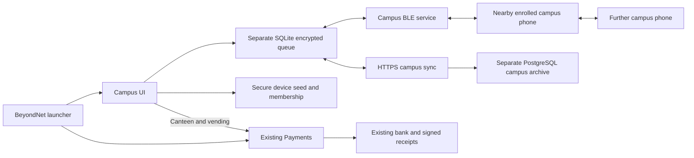

# BeyondNet Campus branch

Opening BeyondNet now offers **Offline Payments** and **Campus**. Payments opens
the original enrollment, wallet, QR, PIN and relay screens. Campus has its own
college-issued identity and local database; no campus action debits the ledger.
Canteen/vending opens Payments to scan a bank-verified merchant QR. A pending
payment still requires the existing signed bank receipt before it counts as paid.

## Join a college

The college operator supplies a campus code, HTTPS server origin and SHA-256
fingerprint of the campus Ed25519 public key. The phone checks that fingerprint
before transmitting Campus credentials. Enter an ERP/student ID or faculty ID,
select the corresponding role and enter the **Campus-specific password** issued
by the operator. The server roster determines role, section memberships and
posting permissions. There is no self-service elevation to professor or HOD.
These credentials are separate from the payment account and the actual ERP;
production ERP/SSO integration requires the college's identity-provider contract.

The role matrix is enforced with signed read/write grants on every message:

| Group kind | Readers | Writers |
| --- | --- | --- |
| `section` | Roster-assigned members | Assigned members |
| `faculty` | Roster-assigned members | Assigned professors, HOD, authority |
| `authority` | Roster-assigned members | Assigned HOD, authority |

Staff can post text assignments. HOD/authority can post text notices. Notice
cards appear first. Group membership must include all intended recipients; the
server never assumes that every student belongs to every section.

## Operator provisioning

Run the existing bank backend with Java 21 and PostgreSQL, as in the root README.
The campus API uses the same HTTPS origin under `/api/campus`, with separate
PostgreSQL tables, signing keys and encrypted packets. Operator provisioning is
restricted by the existing localhost-only `/api/admin` filter and operator key.
It does not add a public administrator sign-up.

Create a private roster JSON, for example (replace all values with college data):

```json
{
  "code": "COLLEGE-2026",
  "name": "College name",
  "groups": {
    "cse-a": {"name": "CSE · Section A", "kind": "section"},
    "cse-faculty": {"name": "CSE assignments", "kind": "faculty"},
    "college-notices": {"name": "College notices", "kind": "authority"}
  },
  "members": [
    {"id": "STUDENT_ERP_ID", "name": "Student name", "role": "student", "groups": ["cse-a", "cse-faculty", "college-notices"]},
    {"id": "STAFF_ID", "name": "Professor name", "role": "professor", "groups": ["cse-a", "cse-faculty", "college-notices"]},
    {"id": "HOD_ID", "name": "HOD name", "role": "hod", "groups": ["cse-a", "cse-faculty", "college-notices"]}
  ]
}
```

From the bank computer:

```bash
python3 scripts/provision-campus.py /private/path/roster.json \
  --operator-key-file data/admin-token.txt
```

The script prompts for Campus-only passwords (minimum ten characters), submits
over loopback and prints only the public campus code/key/fingerprint. Passwords
are stored as salted scrypt hashes; the phone never persists the password. Share
the code, HTTPS origin and fingerprint through a trusted college channel. Do not
commit real rosters or credentials. The existing request limit is 16 KB, so this
provisioning endpoint is intended for a pilot roster, not a whole university.
Unknown IDs cannot enroll. Do not use real ERP passwords for this pilot.

A campus code is an immutable roster/key epoch: overwriting it is rejected. For
membership changes or key rotation provision a new code, distribute it securely,
and have affected users leave the old campus and join the new one. Immediate
revocation/key rotation and incremental roster imports need an institutional
administration service before production deployment.

## Delivery architecture



* Authority signs device membership, including group read/write grants and a
  24-hour expiry. Campus keys never substitute for bank device keys.
* Each group has an AES-256-GCM key shared only with assigned members. Text and
  assignment/notice type are encrypted with campus/group/domain authenticated
  data. Sender Ed25519 signs routing context, timestamps and ciphertext. The
  signed-envelope digest is the immutable deduplication ID.
* Same-campus relays verify authority and sender signatures, write grants,
  campus scope, ID, expiry and size before persisting a packet. They can carry
  packets for other groups without those groups' decryption keys. Group IDs,
  certificate identity and timing remain visible routing metadata.
* BLE reuses the existing bounded, indexed GATT framing under **different UUIDs**
  (`f953c620/621/622-4f9e-4ac8-a6d6-6f666b61726f`). Existing payment defaults and
  wire packets are preserved. Authority notices carry a signed priority and are offered before ordinary messages. Inventories page 16 IDs at a time; packet pulls
  and offers are bounded and rotate through neighbors and the local queue.
* Enrolled phones periodically upload pending packets and pull a durable server
  cursor feed. A signed server response binds the request nonce and acceptance
  ID. Cursor and accepted-state updates commit together; interruption retries
  the same packet ID. Server uniqueness prevents duplicate storage.
* Each phone stores at most 512 active packets; a campus server holds at most
  100,000 active packets. Expired packets are cleaned on acceptance. Messages
  expire with their author's membership (at most 24 hours), not indefinitely.
  A full phone queue refuses new packets and does not advance past an unaccepted
  feed entry. Group data cannot be read after the signed membership expires.
* UI distinguishes **Saved locally**, **Copied to a peer**, and **Server accepted**.
  None means that every recipient has received or read the message. Delivery
  depends on contact opportunities, Bluetooth permissions, phone availability,
  clock agreement within two minutes and a connected gateway for server sync.

## Bluetooth ownership and practical limits

Campus Bluetooth is explicitly enabled in Campus and runs **in the foreground**.
Starting it pauses an active Payments relay because the Android GATT service has
one owner. Leaving Campus, opening Payments or backgrounding the app stops
Campus Bluetooth. Re-enable the existing Payments background relay in Payments
when needed. Campus server sync continues opportunistically while the process
is alive, but no campus background execution or delivery SLA is promised.

This is a store-and-forward mesh pilot, not Bluetooth SIG Mesh provisioning.
It supports text messages/assignments/notices, not file attachments, read receipts,
push notifications or guaranteed emergency delivery. Use installed, powered
campus gateways and a separately validated emergency channel for critical alerts.
Offline revocation cannot be instantaneous; the 24-hour certificate lifetime
bounds stale authority. Removing a member requires a new key epoch to exclude
that member from subsequent encrypted content.

## Validation and acceptance

On this branch, `mvn -o -f backend/pom.xml test` passed **51 tests**: 46 existing
bank/wire/request-limit tests and 5 campus tests. Packaging also passed. Campus
tests exercise server-issued roles, staff-only posting, signatures, expiry,
deduplication, cursor feeds, persistence and payment-ledger isolation.

New `mobile/test/campus_test.dart` covers the launcher/payment entry, encrypted
multi-hop forwarding, group confidentiality, duplicate offers, SQLite reopening,
role checks, replay checks and HTTPS-origin validation. These tests and the full
Flutter suite must pass before release. This environment has no Flutter SDK;
the official Flutter SDK metadata/archive endpoints returned HTTP 404, so mobile
analysis, tests and APK compilation have **not** been run here. Dart 3.13.7 was downloaded separately and successfully parsed/formatted all changed Dart files; this is not Flutter type checking. Independent Python
payment integration tests are also blocked by missing Python test dependencies.
The branch includes a GitHub Actions workflow for backend and Flutter checks.
Do not treat the presence of that workflow as a passing CI result.

Required physical acceptance before deploying to students:

1. Enroll student A, student B, professor and HOD against a private test roster.
2. Confirm each ID sees only its assigned sections; students cannot send to
   staff-only groups and professors cannot impersonate HOD.
3. Disable Wi-Fi/mobile data on A and the professor; enable Campus Bluetooth on
   A, B and the professor. Publish an assignment and verify A can read it through
   B after the professor is out of range. Repeat with an HOD notice.
4. Kill/restart phones between copies, reconnect a gateway and verify server
   acceptance with the same message ID and no duplicate cards.
5. Try a different-campus phone, expired certificate, wrong fingerprint and
   denied Bluetooth permissions. Confirm errors never become successful delivery.
6. Open canteen/vending Payments, scan a merchant QR and run existing offline
   payment acceptance. Check that only a verified bank receipt marks it paid.
7. Exercise back navigation, app backgrounding and both relay mode switches;
   verify Payments can restart its original relay and Campus does not claim to
   keep carrying messages after leaving the foreground.
