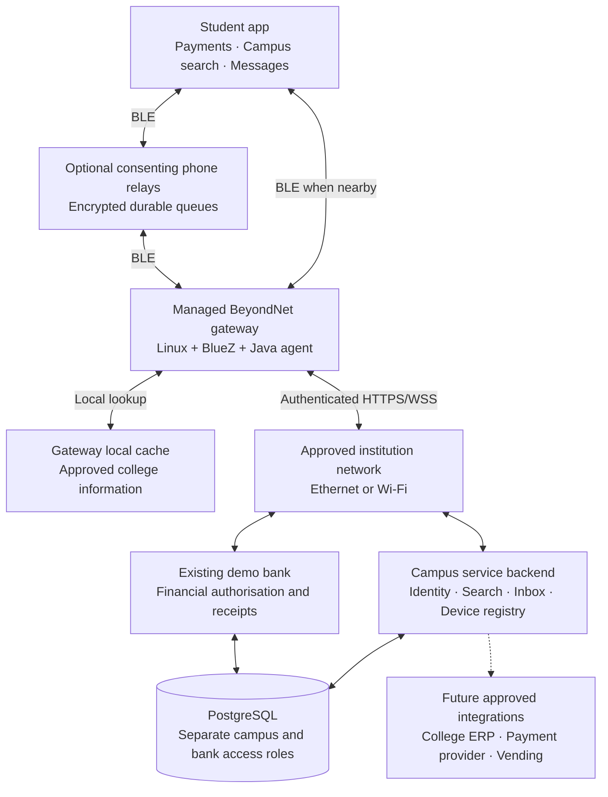

# BeyondNet campus platform — proposed design

Date: 17 October 2026. Planning document; the campus features and Linux gateway described here are **not implemented**. Existing payment behaviour is described separately from proposed changes. Final evaluation: 25 October 2026.

## 1. Purpose and boundaries

BeyondNet can become a campus service platform in which students use one Android app to access small, authenticated requests through nearby phones or institution-operated gateways. The institution supplies the gateway's approved network connection. Students do not receive its Wi-Fi credentials.

Initial services: demo payments, campus information search, and later asynchronous text messaging. Subsequent integrations: canteen/vending orders, library services, service requests and fee invoices. Actual money and college ERP access require separate institutional and payment-provider integration; demo balances cannot pay real fees.

The platform provides controlled access to named services. It is not a general internet connection, browser, VPN, arbitrary HTTP proxy or substitute for campus network capacity. An approved student Wi-Fi network may be the simpler solution for general internet access. BeyondNet is useful when the objective is narrow service access, durable requests and intermittent connectivity.

The college IT team must explicitly authorise the uplink and its use for these services. A Wi-Fi password alone does not establish permission to operate a gateway. Network credentials remain on managed gateway hardware. No gateway deployment or external integration is authorised by this design document itself.

## 2. Baseline inspected

The repository currently provides:

- Flutter Android app with a native Kotlin opt-in foreground service.
- Custom BLE GATT store-and-forward routing, authenticated peer RPCs and durable phone queues.
- Indexed GATT framing in mobile 1.3.6, with the earlier characteristic retained.
- Explicit relay approval and next-phone selection for offline intermediates.
- Java Spring Boot demo bank and PostgreSQL financial ledger.
- Bank-signed device certificates, Ed25519 signatures and versioned X25519/HKDF/AES-GCM financial encryption.
- Payment idempotency, ten-minute authorisation expiry and durable bank receipt recovery.

Two physical phones have completed an offline payer → online phone gateway payment and returned the signed receipt. Physical three/four-phone chains, a Raspberry Pi gateway, campus messaging and campus search have not been validated or shipped. Automated routing tests are not evidence of physical radio coverage.

Important current limits from `PROTOCOL.md`: financial packets are capped at 8,192 canonical bytes; peer RPCs at 12,288 bytes; the routing hop limit is four; recipient ID resolution does not recursively search arbitrary offline relays. Keep these limits until changes are separately designed and tested.

## 3. Architecture



Students can connect directly to a reachable gateway; a phone chain is needed only to extend reach or carry requests through an interruption. Gateways already attached to the campus LAN should use that LAN to communicate with services rather than create an unnecessary Bluetooth chain between themselves.

The bank remains internet-only in the current deployment. BLE terminates at a phone or managed gateway. The bank can stay remote. A college-hosted backend could eventually run without the developer laptop, but it still requires maintained power, network access, monitoring and backups.

## 4. Service feasibility

| Service | What Bluetooth carries | Offline behaviour | Initial scope |
|---|---|---|---|
| Demo payments | Existing encrypted bank packet and receipt | Queue until gateway reaches bank within authorisation window | Reuse current bank |
| Campus search | Short query and a few text results | Search a signed, dated local public information cache | Recommended first new service |
| Text messaging | Small recipient-encrypted messages and acknowledgements | Store and forward; eventual delivery when a route exists | After gateway interoperability |
| Announcements | Signed text notices with version and expiry | Cached notices remain available with freshness label | Natural extension of campus search |
| Web search | Query plus small text result list | Wait for online upstream; cached results explicitly dated | Later, approved provider/API required |
| Library/helpdesk | Structured request and authoritative response | Request can queue; booking/reservation stays unconfirmed until backend accepts | Later college integration |
| Vending/canteen | Signed invoice, payment result, order status | Never dispense solely on queued payment or relay acknowledgement | Simulation first |
| College fees | Verified invoice and payment/reconciliation status | Submission is not proof the fee is paid | ERP/provider integration later |
| Video, large PDFs, ordinary browsing | Large/continuous transfers | Poor initial fit for this transport | Separate approved Wi-Fi delivery |

Use BLE first for small requests. If students eventually need large content, design a separate controlled Wi-Fi service network, authenticated local HTTPS and Android network-selection flow. Do not promise seamless Wi-Fi handover on all phones. A separate Wi-Fi adapter or Ethernet uplink may be needed; do not assume a single radio can reliably operate as institution Wi-Fi client and student access point simultaneously.

## 5. Hardware and deployment

No purchase is required to validate the basic service concept. A spare Android phone can first act as a fixed, powered gateway using the existing payment implementation. New campus service support still needs software work; existing gateway functionality alone does not provide search or messaging.

For a headless Linux gateway, evaluate a Raspberry Pi 4 or 5 with a suitable power supply, case, storage and Bluetooth support. A Pi 5 provides BLE, Wi-Fi and Ethernet, but it is not required merely to relay small messages. Borrow hardware where possible and validate the selected adapter/OS before buying multiple units.

Proposed pilot equipment:

1. One gateway for initial phone-to-Linux interoperability; two for later failover tests.
2. Approved Ethernet uplink where available; otherwise institution-provisioned Wi-Fi credentials.
3. Reliable power; UPS/PoE options where appropriate and supported by the chosen equipment.
4. Small bounded storage for encrypted queues and public content cache.
5. Four available Android phones for direct, multi-hop and competing-gateway scenarios.

Place gateways close to student activity: library entrance, canteen counter or a corridor. Survey walls, interference, queueing and simultaneous usage. Do not claim a fixed range or campus-wide coverage from hardware specifications. Gateway count follows measured coverage and offered load.

Ethernet avoids competition between BLE and the Wi-Fi uplink. When Wi-Fi is required, test 5 GHz where the college network and environment support it. Neither option guarantees radio reliability.

## 6. Proposed technology choices

| Layer | Choice | Reason |
|---|---|---|
| Student app | Existing Flutter/Dart + Kotlin service | Retains payment investment and Android background handling |
| BLE gateway OS | Supported Raspberry Pi OS Lite/Linux + BlueZ | Headless operation and GATT/advertising APIs |
| Gateway process | Java 21 agent, BlueZ D-Bus integration using a pinned compatible Java binding | Keeps application logic in Java; needs a hardware interoperability spike |
| Process supervision | systemd | Start on boot, restart on failure, bounded logs |
| Gateway local persistence | Embedded SQLite, bounded queue/cache | Survives restart without installing PostgreSQL on every gateway |
| Campus backend | Java Spring Boot, initially one modular application | Identity, search, inbox and gateway management are manageable together |
| Authoritative storage | PostgreSQL | Durable inbox, unique request constraints, service state and audit records |
| Campus search | PostgreSQL full-text search centrally; SQLite FTS for downloaded public cache | Avoids a separate search cluster for a small corpus |
| Gateway uplink | HTTPS; WSS for low-latency updates with polling recovery | Fits existing architecture; durable delivery cannot depend on socket lifetime |
| Bulk delivery later | Approved local Wi-Fi + HTTPS | Better suited to documents and larger content |

SQLite here is an edge queue/cache, not a replacement for the PostgreSQL bank. Bound its size and avoid secrets in logs. Linux BLE D-Bus callbacks and ATT offsets differ from Android plugin callbacks; the Java binding alone is not a complete gateway implementation.

A message broker, Kubernetes and a separate server per feature are unnecessary for the first pilot. Revisit infrastructure only after measured needs justify it.

## 7. Protocol and compatibility

### Preserve payments

Keep the current financial packet, canonicalisation, signature verification, payment ID, amount representation and ten-minute authorisation semantics unchanged. A gateway transports the existing ciphertext; it cannot create a payment on the student's behalf. No payment PIN or bank private key belongs on a gateway.

The first Linux spike must implement the existing service and indexed characteristic from `PROTOCOL.md`, including transfer tags, frame indices, duplicate-write behaviour, response cursors, MTU fallback, timeouts and size bounds. Compare Dart and Java golden test vectors. Advertising a UUID without implementing these behaviours is insufficient.

Do not put a human account password or the bank operator key on shared gateway hardware. Add provisioned gateway identities with narrow submit/receipt-recovery permissions, expiry and revocation. Current customer-session authentication is not already a production gateway identity system; backend and phone certificate handling need explicit additions and compatibility tests.

### Add campus services separately

Create a new versioned campus service characteristic or service UUID with explicit capability negotiation. Old payment apps continue the payment protocol. They must never receive campus objects through a legacy path that treats unknown kinds as payment-like traffic.

Proposed logical envelope fields:

- Protocol version, service type, request UUID and originating device identity.
- Recipient identity or an approved named service, not a user-supplied URL.
- Creation time, service-specific expiry and immutable payload commitment.
- Signed immutable header, encrypted payload and bounded mutable routing metadata.

Define exact canonical bytes, domain separation, key ownership, response binding, replay handling and size limits before implementing the envelope. Do not concatenate ad hoc JSON signatures or reuse cryptographic nonces. Signed claims of internet availability are observations by a gateway, not proof of delivery or settlement.

Candidate initial application limits, to be validated: text message up to 1 KiB, search query up to 256 UTF-8 bytes, search response up to 4 KiB with a small paginated result list. These are design proposals, not current app limits. No attachment fragmentation feature is needed for the first pilot.

Payment expiry stays at 600 seconds. Suggested campus message retention could be 24 hours; an interactive search request could expire after 60 seconds. Final policies must be visible to users. Physical hop counts and time duration are different limits.

## 8. Security and permission model

Trust boundaries:

- Relaying students transport ciphertext; financial plaintext remains with payer and bank.
- A campus search service must read a query to answer it. Local cache search on a Pi therefore makes that Pi an authorised search endpoint; do not claim the search query is hidden from it.
- Text messages should be encrypted for the recipient, not merely for the gateway. Gateways and the inbox retain ciphertext. Use a separately reviewed messaging key protocol, initially acknowledging the lack of forward secrecy if only the existing static-recipient box is reused.
- Content publishers sign cache manifests and announcements. Students can see source and last-updated time. Start with public college information; private records require identity and access checks even when cached.

Gateway discovery can be public, but identity must be verified against pinned trust. Do not trust a device simply because it advertises “College Gateway.” Keep identity linking between campus accounts and payment accounts explicit; separate service roles, credentials and permissions.

Gateway controls: per-device quotas, bounded queues, fair scheduling, approved destination list, revocation, rotation, restricted OS account, limited network access and minimal metadata logs. Incoming user packets must not select arbitrary internal IPs, URLs, filesystem paths or shell commands.

Gateway approval can be automatic under the institution's configured policy. Student-phone relay participation remains opt-in, with the existing explicit payment approval flow initially preserved. A new automatic policy must never silently change that behaviour on users' phones.

No shared SSID password is delivered to students. IT may place gateways in a dedicated network segment, allowing only required endpoints and blocking access to administrative/student information systems except through approved service APIs.

## 9. Routing, scheduling and delivery

Start with direct verified gateway access when reachable. Otherwise use existing bounded phone forwarding. Display separate observed capabilities: bank reachable, campus backend reachable, public cache available, protocol support and queue availability. One `online` flag cannot describe all these states.

The existing four-hop limit remains. Deduplicate by stable request ID plus immutable payload commitment, keep persisted seen IDs through the relevant replay window, and prevent immediate bounce-back using per-transfer sender identity and visited hints. Routing hints remain advisory and cannot authorise any financial effect.

A custody acknowledgement is emitted only after durable persistence. It means the next device accepted responsibility for storing the request, not that the destination completed it. Retries use the original request ID. Failed attempts back off; users can choose an alternate route. A gateway disconnect after backend acceptance is a receipt-recovery problem, not permission to generate a replacement payment.

Separate queues for receipts/payments, interactive campus requests and background content. Give payment outcomes prompt service but use fair scheduling to avoid starving messages. Set byte and per-user limits; a popular chat room must not fill the payment queue.

Use at-least-once transport with idempotent application effects. The bank already enforces financial idempotency. New message inboxes need unique sender/message IDs and conflicting-body rejection. Reading a message requires recipient confirmation; gateway custody is not “delivered” or “read.” Search responses are bound to their originating query ID.

Receipts and inbox responses must be recoverable through any authorised gateway or a later direct connection. Multi-gateway synchronisation uses the backend's durable inbox/cursors. When a backend is unreachable, delivery is limited to locally cached or physically carried data; do not imply global offline synchronisation.

## 10. Service flows

### Campus information search

1. Student chooses Campus and enters a short query.
2. App uses a fresh verified on-phone cache if it can answer locally.
3. Otherwise app sends an authenticated request to an authorised search endpoint through a reachable gateway or relay chain.
4. A gateway authorised to search its public cache returns signed, dated snippets; if needed it calls the campus backend.
5. App validates response identity, query ID and freshness before display.
6. If neither cache nor backend can answer, show that limitation rather than inventing a result.

Start with 30–50 approved records: department contacts, opening times, campus locations, official notices, library instructions and FAQ. Web search is a separate later integration with a licensed/approved provider, bounded snippets, privacy policy and cost controls. It is not Google access magically made offline.

### Asynchronous student messaging

1. Resolve the recipient's institution-verified identity/key using a signed directory.
2. Encrypt a short message for the recipient; save it before transmission.
3. Relay/gateway acknowledges durable custody.
4. Backend deduplicates and queues ciphertext in the recipient inbox.
5. Recipient fetches through a gateway or direct internet when reachable, verifies and decrypts it.
6. Recipient emits an authenticated delivery acknowledgement; read acknowledgement is separate and optional.

Unknown recipients and stale/revoked keys need a visible failure or renewal path. A recipient with no contact with any route cannot receive instantly. Group chat, attachments, forward-secure sessions and full offline directory changes require additional design.

### Payments, vending and fees

Existing demo payments can use a managed gateway while keeping bank verification and receipts unchanged. First extend dedicated gateway authentication and test backwards compatibility.

For future vending, use a signed merchant invoice bound to machine, amount, order ID, item and expiry. A machine/controller independently verifies the bank/provider result and durably records order fulfilment. Repeated receipts or commands cannot dispense another item. A power cut between actuation and recording can leave physical fulfilment uncertain; use sensors and reconciliation/refund handling rather than claiming software alone guarantees exactly one physical dispense.

Fee payments require ERP-issued invoices, authorised payment-provider integration, provider-confirmed settlement and reconciliation with the student's fee record. A demo success screen cannot establish fee clearance. Keep this outside the immediate evaluation build.

## 11. Outage behaviour

| Failure | Required behaviour |
|---|---|
| Gateway internet down; local cache intact | Cached public information available; payments queue without false success |
| Campus LAN available; internet down | Campus services work only if their hosting and dependencies are actually reachable on the LAN |
| Neon/bank unreachable | Current financial settlement unavailable; no local balance mutation pretending to be bank settlement |
| Gateway restart/power loss | Recover persisted queue; deduplicate retries; expose unavailable status while restarting |
| Gateway receives duplicate from several phones | One logical backend effect; recover same result |
| Storage full/over quota | Refuse custody explicitly; retain original sender copy |
| Gateway compromised | Revoke its credentials; financial ciphertext remains bank-encrypted, but metadata/availability and any authorised search plaintext may be exposed |
| Phone force-stopped or Bluetooth disabled | Explain that phone relaying is unavailable; managed gateway cannot overcome a disabled phone radio |
| Payment expiry without confirmed outcome | Preserve original recovery state; bank decision is authoritative |

Initial enrolment and renewal still require a reachable identity service. Pre-enrol evaluation devices. Future campus-local enrolment needs an explicit delegated trust design, not a promise of first-time signup while all services are disconnected.

## 12. Implementation organisation

Proposed additions, not existing modules:

```text
gateway/                   Java Linux process: BlueZ adapter, protocol, queue, uplink
campus-backend/            Spring Boot: campus identity, search, inbox, gateway registry
contracts/                Versioned schemas, capabilities, canonical golden vectors
mobile/lib/campus/        Campus UI and feature-specific request handling
mobile/lib/messaging/     Recipient directory, ciphertext inbox and message UI
docs/campus/              Deployment, network approval, acceptance tests and operations
```

Keep `backend/` as the authoritative demo bank. Use separate database credentials/schema boundaries for campus data, avoid exposing bank administration to gateways, and preserve existing app IDs, bank identity, signing keys and stored account history. Shared protocol code can become a library only after its boundaries are established; do not reorganise the whole repo to begin the spike.

Developer work packages in dependency order:

1. Freeze and reproduce the current payment baseline on three physical phones.
2. Specify gateway principal/authentication, capability negotiation and canonical interoperability vectors.
3. Build Linux peripheral advertising and indexed GATT request/response spike on borrowed hardware.
4. Implement durable gateway queue and bank upload/recovery; test one full existing-format payment.
5. Add a versioned campus transport and public-content cache endpoint.
6. Add one Campus search screen and signed response validation.
7. Add separate campus inbox/identity modules, then asynchronous text messaging.
8. Test multiple gateways, quotas, revocation, radio load and recovery.
9. Pilot with institutional approval and measured coverage before adding ERP/vending integrations.

## 13. Acceptance gates

Payment regression: preserve successful direct online and phone-only offline flows, wrong-PIN/funds rejection, expiry, original-ID reconciliation, concurrent duplicates, unchanged account history and exactly one debit/credit.

Gateway radio interoperability: indexed frames at fallback and negotiated MTUs, repeated reads/writes, disconnect mid-frame, ATT offset handling, malformed requests, Android 10+ devices, Wi-Fi/BLE coexistence and recovery after Bluetooth adapter restart.

Physical topology: direct phone → gateway; offline A → offline B → gateway with A unable to reach gateway; A → B → C → gateway with shortcuts prevented; redundant gateways receiving the same packet. A route restriction must be disclosed if it is used instead of physical separation.

Campus features: search is correct and dated while gateway uplink is disconnected; altered cache manifests are rejected; user cannot request arbitrary URLs; message duplicates do not duplicate inbox entries; unauthorised users cannot read private records or ciphertext addressed to someone else; old payment peers reject/ignore campus capability safely.

Load: begin with 1, 2, 5 and 10 active students and increasing offered request rates. Record discovery success, p50/p95 transfer time, approval time separately, queue depth, completion rate, retries, power loss recovery and memory. Do not advertise support for hundreds of simultaneous BLE connections from a one-gateway demonstration.

Evidence: ten consecutive three-device payment runs is a useful initial demo gate, not statistical certification. Keep failure logs, topology diagram, APK hashes, gateway build/adapter details and ledger evidence. Simulated results and physical results must be labelled separately.

## 14. Delivery plan and evaluation scope

Full campus rollout is a multi-stage engineering project with external dependencies. No hardware or institute network access has been confirmed as of this plan. Calendar estimates depend on borrowing equipment, API access, approval and physical tests; a full rollout cannot be promised before 25 October.

- **17–18 October:** reproduce the physical three-phone baseline, define one campus use case and request hardware/network access through the appropriate college process.
- **19–20 October:** if hardware is available, time-box Linux BLE interoperability and managed-gateway authentication. Stop expanding scope if this blocks the existing payment demonstration.
- **21–22 October:** only after gateway payment tests pass, add a small read-only campus FAQ/search demonstration. Android-only concept demonstration is possible if Linux hardware remains unavailable; identify it accurately.
- **23 October:** physical regression tests and mentor rehearsal. Text messaging can remain a designed future feature.
- **24 October:** freeze the evaluation build, capture a real recording, verify equipment and rehearse.
- **After evaluation:** implement messaging, multiple gateways and a supervised small-user pilot; then consider controlled Wi-Fi content delivery and real institutional integrations.

Six proposed ownership areas: mobile UX, BLE/gateway transport, backend/database, identity/security, physical reliability testing, and college coordination/content/presentation. Describe actual contributions honestly when presenting the team.

Decision gates: borrow before buying; one gateway before buying several; one reliable service before adding many; measured usage before selecting campus-wide hardware quantities.

## 15. References

External references support technology feasibility; they do not establish that BeyondNet campus features are implemented, interoperable or secure.

- [Bluetooth SIG: Bluetooth internet gateway study guide](https://www.bluetooth.com/blog/the-bluetooth-internet-gateway-study-guide/) — gateway concept and Raspberry Pi example.
- [BlueZ GATT API](https://bluez.readthedocs.io/en/latest/gatt-api/) and [advertising API](https://bluez.readthedocs.io/en/latest/advertising-api/) — Linux integration surfaces.
- [Java D-Bus binding](https://github.com/hypfvieh/dbus-java) — candidate Java integration; pin and test compatible versions.
- [Raspberry Pi 5 product brief](https://datasheets.raspberrypi.com/rpi5/raspberry-pi-5-product-brief.pdf) — BLE, Wi-Fi and Ethernet hardware capabilities.
- [Raspberry Pi configuration documentation](https://www.raspberrypi.com/documentation/computers/configuration.html) — network management and hotspot configuration.
- [PostgreSQL full-text search](https://www.postgresql.org/docs/current/textsearch.html) — built-in campus corpus indexing and search.
- Local baseline: `PROTOCOL.md`, `VALIDATION.md`, `BACKGROUND_RELAY.md` and `SECURITY_ROADMAP.md`.
