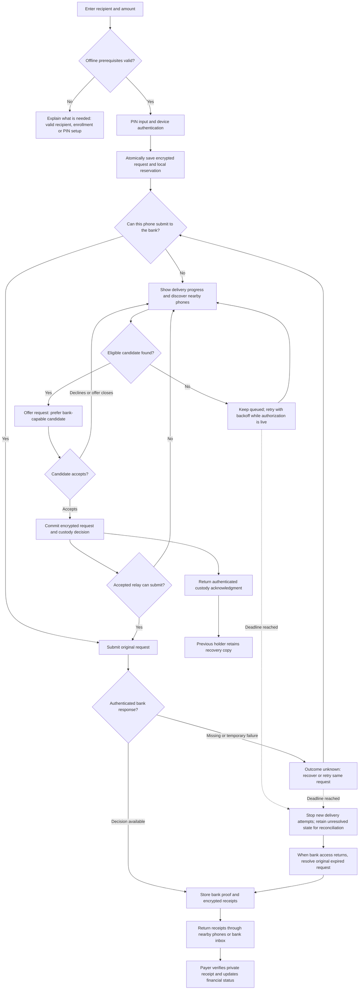

# BeyondNet: payment-first, multi-phone relay plan — revision 2

Status: revised design for later implementation. No app or server behavior has been changed. Revised 30 October 2026 after reviewing the current payment, custody, routing, bank validation and receipt-recovery code.

## 1. Decisions after the second review

Keep the requested experience: authorize first, then deliver directly or through nearby phones. Remove connection approval as a user-facing prerequisite. Each relay accepts a particular encrypted request once, then automatically tries the bank or another relay.

Improve the first plan in these ways:

- Separate ability to authorize, ability to accept custody, and ability to submit to the bank. An offline phone can accept custody without a known onward route.
- Account for offline recipient lookup, bank sessions, PIN checking and cached funds before promising offline creation.
- Prefer a working bank connection, not merely Wi-Fi/mobile data or a claimed online route.
- Define durable handoff and lost-acknowledgment recovery; accepting a notification and receiving custody are distinct until storage commits.
- Limit duplicate spreading over the lifetime of a request at a device, not just simultaneous connections. Do not promise a global copy limit that disconnected phones cannot enforce.
- Distinguish packet identifiers visible to relays from the encrypted payment identifier used by the bank.
- Add bank-authenticated delivery evidence that relays can verify without reading private receipts.
- Treat expiry, receipt delay, wrong PIN, clock changes and failed bank requests explicitly. None is automatically a successful payment or proof that no debit occurred.
- Treat notifications as entry points into a persistent inbox, not as the only way to accept requests.
- Prove three-phone forwarding before expanding hop limits and larger-network claims.

## 2. Product contract and boundaries

A payer enters recipient and amount, supplies their PIN and completes device authentication. Save one signed, encrypted authorization and its local reservation atomically before delivery starts. If the bank is reachable and the phone can submit, send directly. Otherwise open the delivery screen and search for eligible nearby phones.

Each new relay may accept or decline that request. Accepting means “store and automatically try to deliver this encrypted request”; it does not authorize a payment from the relay's account. The relay never enters the payer's PIN and cannot alter the signed recipient or amount. No second confirmation is needed when an accepted offline relay subsequently gets internet. Nearby peer authentication remains mandatory but does not require a separate connection-approval screen.

An offline relay may store the request even with no next phone visible. Phones need contact for each handoff, not a simultaneous end-to-end connection. This is store-and-forward delivery. It needs a path to a functioning bank before the authorization expires; an indefinitely disconnected group cannot complete a bank payment.

Only a bank decision can settle the payment. Local reservations prevent the same installation from accidentally reusing its cached balance; they are not bank-held funds and do not prevent another device on the same account from spending. The bank must enforce balance and duplicate protection atomically.

## 3. Revised flow diagram

The discovery loop belongs to whichever phone currently carries the request; it does not force the payer to remain present. All forwarding obeys hop, expiry, consent and capacity limits. Reconciliation after expiry is not new authorization and must never extend its lifetime. The bank may return an earlier decision or reject an authorization that arrived too late. Definitive malformed-request/protocol errors require the separate error handling below, not an endless retry loop.

Example: `A offline payer → B offline → C offline → D offline → E bank-capable → bank`. B through E accept once each. Prefer returning the receipt through E, D, C, B, A; allow later contact or bank inbox recovery if that route breaks. A recipient's own receipt is separately addressed to the recipient's enrolled device(s); it must not depend on the payer viewing or forwarding a screenshot.

## 4. Prerequisites hidden by the first plan

| Condition | Required behavior |
| --- | --- |
| New payment ID typed while fully offline | Use a valid previously saved bank-signed recipient certificate or scan a valid recipient QR. Arbitrary new-name lookup cannot work without a reachable source of trusted recipient data. Do not confuse this with relay discovery. |
| PIN entered offline | Device authentication can complete locally, but the current bank verifies the payment PIN. Say “request authorized on this device,” not “bank verified your PIN.” Wrong PIN can produce a later signed rejection. |
| No prior enrollment/PIN setup | Explain that initial setup requires bank access. Do not create a request the bank cannot validate. |
| Stale/expired enrollment or recipient certificate | Request renewal or a fresh QR. Recheck at authorization time; do not silently bypass trust checks. |
| Cached balance | Subtract unresolved local reservations and label it as last-known available balance. The bank still decides whether funds are sufficient. |
| Wi-Fi/mobile data present but bank/tunnel unavailable | Treat as unable to submit. An offline carrier is still useful; a network icon is not a bank route. |
| Gateway session expired/revoked | Relay can retain an accepted request and seek another eligible relay; show its owner a sign-in issue. Do not ask for payer credentials. |
| Bluetooth off, missing permission, relay service unavailable | Preserve the authorized request; offer the action needed to enable delivery. Do not discard it and request the PIN again. |
| Phone clock changed or untrustworthy | Use last trusted bank-time offset with monotonic elapsed time where possible. If time uncertainty prevents safe authorization, explain the need to reconnect. Local clock edits cannot extend the bank deadline. |

Do not stretch ten-minute authorization to accommodate a slow chain without separately designing and approving a longer financial authorization policy. The existing backend enforces a maximum of 600 seconds for current PIN-authorized requests.

## 5. State model

Maintain independent durable states; UI reads them instead of inferring success from a connection.

**Payer financial state:** `pending/unknown → paid | rejected`, driven by a verified private bank receipt. Any local pre-authorization error creates no payment. If an authorized request has an unresolved bank outcome, do not automatically release its reservation when a timer expires.

**Delivery state:** `queued → discovering → offer_pending → custody_confirmed → awaiting_bank_result`. It can also be `paused`, `delivery_window_ended` or `needs_attention`. There is no universally known “current owner” in a disconnected network: custody confirms that a named phone committed a copy, not that every previous copy disappeared.

**Relay state:** `pending_consent → accepted_and_stored → seeking_next_hop | submitting → bank_processed → receipt_carriage`. Declined, expired-before-acceptance and capacity-rejected requests never become accepted custody. A bank-processed relay may still owe receipt delivery.

**Identifiers:**

- Relay deduplication and consent use the immutable outer packet digest, which relays can inspect.
- Financial deduplication uses `(sender, payment_id)` and a commitment to the signed instruction at the bank. Relays cannot read this encrypted identifier and must not be required to deduplicate by it.
- Keep the original encrypted packet unchanged across retries; change only permitted routing metadata. Re-encrypting on every handoff would defeat packet deduplication and cause repeated consent prompts.
- A new packet ID is not a new payment permission. Preserve the bank's rejection of the same financial ID with a changed instruction.

## 6. Peer selection and handoff protocol

### Candidate eligibility and ranking

Exclude self, other networks, unsupported protocol versions, visited devices on this path, peers with no capacity, locally blocked peers, and declines for this packet. New carriers must have Nearby relay enabled. Existing accepted packets continue under the owner's explicit delivery preference.

Rank remaining candidates:

1. Recently authenticated peers reporting a working bank submission session.
2. Other eligible carriers, using recent contact stability, available queue capacity and time since unsuccessful attempts.

Do not implement advertised multi-hop distance as a trusted primary metric in the first release. It can be stale or circular. An upstream-route claim may be a weak tie-breaker later, with freshness and loop tests. Current bank access is also only a routing hint until a real submission succeeds.

Start a brief discovery window, then use an offline carrier if no suitable bank-capable peer appears. Never require proof of a complete route before accepting or forwarding. Once a person has a live acceptance prompt, do not continually replace it just because another candidate appears. Any holder gaining bank access can submit the original request immediately, even if another copy is in transit.

### Handoff steps

1. Authenticate the neighbor and exchange supported version, capacity and inventory using bounded messages.
2. Offer the immutable encrypted request in a bounded staging area. Receiving an offer is not custody and must not trigger bank submission before consent.
3. Show one durable inbox item and at most one initial notification for this packet. A duplicate offer returns the recorded state rather than creating another prompt.
4. Accept transactionally commits both consent and packet storage. Recheck deadline, offer state and storage capacity in that transaction. A failed commit cannot return an accepted acknowledgment.
5. Return an authenticated custody acknowledgment bound to packet ID, accepting device and offer attempt. Begin onward work after commit; it need not wait for the previous phone to receive the acknowledgment.
6. If the acknowledgment is lost, query/re-offer the same packet to recover the committed state. Sender timeout alone does not prove that the relay failed to accept.
7. Decline remains recorded for that packet until its retention window ends, including offers arriving from another neighbor. Provide a deliberate user action to reverse a decline, rather than repeatedly nagging them.
8. Give pending offers an explicit deadline and generation. A late tap cannot accept an offer already closed locally; show “This offer has ended.” Network partitions can still leave a previously committed acceptance unknown to the sender—handle that as possible duplicate custody, not guaranteed exclusivity.

### Custody, recovery copies and bounded duplication

Use one pending outward offer per packet per holder. After confirmed custody, retain a passive recovery copy and normally stop competing to forward it. Continue receiving receipts and resolving bank state. Loss of Bluetooth contact is normal after handoff and is not, by itself, evidence of relay failure.

Allow a fallback after a deliberate stall policy, with jitter and a lifetime retry record. Suggested first implementation: at most two distinct downstream custody attempts that might have succeeded per device per packet, including acceptance-ambiguous attempts. Definitive declines can try another eligible peer, within per-peer and total offer rate limits. A successful handoff followed by a short disconnection must not reset these counters.

This is a local resource bound, not a strict network-wide copy bound. Even two branches at every hop can spread widely. Persistent deduplication, hop limits, capacity limits and a conservative fallback delay are mandatory; measure total copies during network simulation. If spread is too high, ship a single-successor mode with the acknowledged availability tradeoff before adding a complex distributed credit protocol. Do not claim both exclusive ownership and automatic recovery under arbitrary disconnection.

Hop budget counts Bluetooth handoffs, not bank requests, declines, scans or retries of the same handoff. At the hop limit, a holder may still submit directly to the bank. Payment and receipt counters are independent. Local ever-seen packet history supplements path/trail checks; route metadata is not signed financial authorization and is not a security guarantee against malicious peers.

## 7. Bank result and receipt delivery

The existing private receipt is bank-signed inside recipient-specific encryption. A relay can carry it but cannot read or verify another user's private decision. A packet hash alone is not bank authenticity. Therefore the first plan's “all relays verify the receipt and stop” needs an explicit protocol addition.

Add a small bank-signed **delivery proof** binding bank/network identity, request packet ID, encrypted receipt packet hashes, decision-recorded time and proof lifetime. It says that the bank recorded a decision; it need not reveal success/rejection, payer, recipient, amount, PIN or balance. A gateway stores this proof and the associated encrypted receipts durably before marking submission finished. Other holders can verify the proof, stop forwarding that payment and prioritize the matching receipts. A proof received alone stops redundant payment submission but triggers receipt recovery; it is not proof that the payer has received the result.

The proof must be issued for committed decisions, including duplicate recovery, and cannot be minted for an arbitrary malformed packet. Bank/app validators, transport inventories and recovery responses must be versioned together. A repeated request with the same signed instruction but a different allowed outer encoding needs a proof for the actual request packet ID; bank financial idempotency remains independent of that envelope.

When relaying receipts:

- Prefer direct delivery to their intended device when possible, then previous custodians, then bounded alternative carriers.
- Use separate traversal metadata so a payment's visited set cannot block the return path.
- The original acceptance includes carrying the corresponding return receipts without another payment approval. Additional receipt-only carriers participate only under explicit Nearby relay consent; do not show a new payment prompt for receipt traffic.
- Payer/recipient decrypt and verify their receipt, network identity, intended device, payment identity, amount/recipient and bank signature before updating financial state. Preserve ledger-revision checks against stale balance rollback.
- Forward only receipts bound to authenticated bank evidence in the new protocol. Encrypted data arriving from a peer without bank evidence must not be treated as a trusted outcome.
- Keep independent receipt retention; the current implementation uses seven days and supports refreshed bank decision receipts. Preserve this recovery path rather than making receipt validity equal the ten-minute payment authorization.
- Persist received receipts before advancing an inbox cursor or confirming delivery. Prioritize receipt traffic without starving new requests.
- Bank proof means “bank recorded a result”; only a verified private receipt lets the payer say “paid.” No UI promises that all holders or the payer have already been notified.

## 8. Failure handling and user control

| Event | Behavior |
| --- | --- |
| Direct submission times out | Retain outcome unknown, query/retry original request, and permit bounded relay fallback with that same request. Never create a replacement payment automatically. |
| Bank records payment but response is lost | Recover original decision by mailbox/request; preserve idempotency under simultaneous gateway retries. |
| Temporary network/server failure | Backoff and retry; re-evaluate gateway eligibility. Avoid one broken gateway monopolizing the request. |
| Malformed/protocol-conflicting request | Quarantine from normal retries and show needs-attention. An HTTP 400/409 alone is not a verified financial rejection and cannot safely release a reservation. Use authoritative recovery where available. |
| Authorization deadline ends | Stop fresh Bluetooth payment forwarding. Keep the original authorization and unresolved reservation for bank reconciliation. |
| Reconnect after expiry | Existing bank logic can return the earlier decision or a signed expiry rejection for the original request. Never renew its timestamp on a relay. |
| Bank decides rejection | Deliver the signed receipt and release/update local reservation once verified. A corrected payment is a new user-authorized request. |
| User leaves payment screen or locks phone | Retain durable state and continue through the supported background service. No second PIN for ordinary delivery retries. |
| User disables Nearby relay | Explain the choice: stop accepting new requests, or also pause existing Bluetooth carriage. Do not silently delete accepted requests. Closing/force-stopping the app can interrupt delivery. |
| User wants to cancel after dispatch | Do not offer an offline “payment canceled” guarantee. Copies cannot be recalled by deleting a local record. Provide status/reconciliation; a bank cancellation protocol is separate future scope. |
| Notification denied or dismissed | Request remains in the in-app relay inbox. No notification means no guaranteed pop-up, not automatic rejection or acceptance. |
| Device storage full | Reject custody before acknowledgment; preserve accepted packets and receipts ahead of optional cache. |
| App update/restart/sign-out | Resume or explicitly pause known work. Do not silently migrate, erase or cross-associate unresolved requests with another signed-in account. Warn before actions that destroy the only local recovery state. |

Display countdowns as delivery-window estimates, not countdowns to guaranteed failure or refund. Do not encourage sending a second payment while the first is financially unresolved.

## 9. Background work, privacy and load

Use one radio/session scheduler across payment and campus features so two parts of the app do not compete to start, stop or monopolize Bluetooth. Keep human consent waiting asynchronous: a person taking 30 seconds to respond must not hold the only BLE connection or block receipt exchange. Persist the inbox first, reconnect for state exchange as needed, and fairly schedule multiple payment requests and neighbors.

Use short active discovery bursts after creation/acceptance, then bounded backoff with jitter; reset appropriately on new peer or connectivity events. Account for near-deadline requests without indefinite high-power scanning. Show queue capacity and pause reasons to the owner, not internal packet counts to ordinary payers. Keep packet/frame size limits compatible with the expanded routing/proof metadata and test transfer on actual phones.

Notifications should be generic on the lock screen. Bind actions to the correct packet/offer, require opening/unlocking the app for acceptance as needed, and prevent stale or replayed action taps. Do not leak raw PINs, mailbox capabilities or payment details in logs. Keep privacy claims precise: ciphertext protects payment content, but peers may observe timing, packet size, adjacent device identity and routing metadata. Do not claim anonymous or untraceable delivery.

A valid enrolled neighbor is not automatically trustworthy: it can lie about internet, drop requests or flood offers. Use per-peer and global offer/storage quotas, cooldowns, block controls and bank-authenticated completion evidence. Offline revocation knowledge can be stale; the bank remains authoritative at submission. No protocol here guarantees delivery through malicious or unavailable relays.

## 10. Initial tuning proposals and scope

| Setting | Initial proposal, subject to tests |
| --- | --- |
| Authorization lifetime | Retain current 600-second bank-enforced limit. |
| Discovery preference window | Approximately 3–5 seconds; do not indefinitely wait for an online peer. |
| Pending human offer | Approximately 30 seconds, capped by remaining authorization; inbox and notification must reflect offer expiry. |
| Active outward offers | One per packet per holder; a bounded shared scheduler across packets. |
| Recovery copies | Retain original/accepted copies for reconciliation; do not automatically make all copies active forwarders. |
| Ambiguous/accepted downstream attempts | Initially at most two distinct candidates per holder over that packet's lifetime; record across restarts. |
| Fallback delay | Start conservatively around 60 seconds without useful authenticated progress; tune with expiry and human-response measurements. Disconnection alone is insufficient. |
| Hop limit | Validate three-phone behavior under existing four-hop limits first; then propose eight Bluetooth handoffs with all validators changed together. |
| Receipt retention | Preserve existing seven-day delivery/recovery behavior and independent receipt hop budget. |

These are engineering experiment settings, not delivery-time, supported-device-count or battery-life promises. Eight hops and ten minutes may be inadequate when many people delay acceptance. The UI must honestly show that a request is waiting.

Exclude from the first release: unlimited routing, automatic approval of other people's payments, full-network live maps, reward payments, remote recall/cancellation and anonymous-routing claims. Optional trusted auto-carry policies would require explicit separate user consent and are not implied by enabling Nearby relay.

## 11. Implementation map and release order

| Area | Required work |
| --- | --- |
| `mobile/lib/main.dart` | Payment-first form, offline recipient guidance, post-authorization delivery view, persistent relay inbox and revised status language. Remove connection-first gating. |
| `mobile/lib/engine.dart` | Separate authorize/carry/submit eligibility; remove both connectivity checks inside `_pay` while retaining financial/trust checks; schedule automatic onward delivery; preserve same ID through all fallbacks. Handle bank proofs and receipt recovery. |
| `mobile/lib/store.dart` | Atomic request/reservation and consent/custody persistence; offer generations, attempts, cooldowns, acknowledgments and separate financial/delivery state; crash-safe migrations. |
| `mobile/lib/relay_routing.dart` | Ranked selection, conservative fallback, explicit hop counting, persistent deduplication and fairness. |
| `mobile/lib/protocol.dart`, inventory validators | Negotiated capability/version, consistent payment/receipt route limits, proof validation, packet-size bounds and replay-safe offer actions. |
| `backend/.../WireCrypto.java` | Match version/hop/path/trail changes; retain packet validation. |
| `backend/.../BankService.java` and response contracts | Delivery proof issuance and recovery; preserve existing signature, PIN, expiry, mailbox and atomic financial idempotency protections. |
| Android host/notifications | Durable inbox entry points, restart recovery, permission handling and shared radio ownership. |
| Automated tests/docs | Multi-hop topology, failure injection, migration and physical-device procedure. |

1. Specify and test the state/protocol contracts, including bank proof and ambiguous handoff. Confirm all current direct-payment regression tests stay valid.
2. Implement durable offline creation and payment-first screens without weakening recipient, PIN, balance or enrollment requirements.
3. Implement unified per-request consent and automatic onward scheduling. Demonstrate A/B offline with C online, requiring two real Bluetooth handoffs.
4. Add loss, duplication, restart, fairness and receipt-recovery coverage. Measure spread under fallback policies before enabling them broadly.
5. Update hop/path/trail limits consistently and test eight handoffs plus the boundary. Add a protocol compatibility matrix; never silently use legacy `put` forwarding to bypass per-payment consent.
6. Deploy compatible bank support before enabling new client behavior. Use a feature flag and same new build on all trial phones. Unsupported peers are explicitly ineligible for the new flow.
7. Migrate existing pending payments and approved packets without changing financial IDs, losing reservations or silently treating old connection approval as new per-payment consent. Already accepted payment consent may be preserved where its scope matches; otherwise request the required new consent. Rollback must preserve unresolved records.
8. Package an APK only after automated gates and controlled three-/five-phone tests pass. Prove the largest claimed topology separately; do not infer eight-hop support from five phones.

## 12. Test and acceptance matrix

| Test | Pass condition |
| --- | --- |
| Online payer | Direct bank flow unaffected; no relay approval needed. |
| Offline new recipient entry | Valid cached recipient or QR works; unsupported lookup gives actionable guidance before creating an invalid request. |
| Wrong PIN while offline | Saved request receives later signed rejection; UI never claims the PIN was bank-verified locally. |
| A offline, B online | One B acceptance, automatic submit, verified receipt returns. |
| A/B offline, C online | B accepts with no known bank route; finds C automatically; C accepts; A stays offline through receipt delivery. |
| Five-phone enforced chain | Four Bluetooth handoffs actually observed; each accepts once; correct single bank decision. |
| Whole group offline, one later online | That holder submits before expiry; no new authorization required. |
| Wi-Fi on but bank unreachable or gateway session expired | Candidate fails over correctly; no false bank-connected or paid state. |
| Online candidate declines, offline candidate available | Offline handoff proceeds within bounded delay. |
| Acceptance commits, acknowledgment lost | Re-offer recovers stored decision; one prompt, no lost accepted copy. |
| Offer times out, user taps stale notification | No unintended new acceptance; correct expired state. |
| Two holders concurrently submit | One ledger effect; consistent decision receipts and matching bank proofs. |
| Bank commits, response lost; authorization then expires | Original decision recovered; no second debit or premature reservation release. |
| Fabricated custody/progress/completion | Invalid evidence cannot mark paid or suppress delivery as bank-complete. |
| Duplicate receipt, wrong target, stale balance revision | No forged status, recipient confusion or balance rollback. |
| Route cycle, stale hints, maliciously edited trail | Honest nodes use dedup/rate bounds; no claim that mutable trails provide adversarial global loop prevention. |
| Packet reaches hop limit | No further Bluetooth payment handoff; direct bank submit still allowed; independent receipt return works. |
| Concurrent payers plus campus traffic | No starvation, overlapping radio ownership or unbounded notification/queue growth. |
| Restart at each write/ack boundary | Accepted requests and financial reservations survive; no duplicate consent action. |
| Storage full/permission revoked/locked screen | Honest paused/rejected-custody behavior; no false durable acknowledgment. |
| Receipt chain breaks or all phones move apart | No premature paid UI; recovery after renewed contact or bank access. |
| App upgrade, legacy neighbor, account switch | No approval bypass, identity confusion, lost reservation or changed payment ID. |
| Clock ahead/backward and reboot | Bank expiry remains authoritative; no artificially extended request. |
| Eight-handoff chain and one extra handoff | Supported boundary succeeds; extra forwarding correctly refused. |

Use an automated topology harness with deterministic time, delayed consent, dropped acknowledgments, bank outages, crashes and duplicate deliveries. Record bank ledger effects, consent events, custody commits, actual hop paths, live copies, retries and queue sizes. Acceptance requires at most one financial execution per instruction, no forwarding without required consent, no accepted-acknowledged packet lost through a normal crash, and no payer success without a matching verified receipt. Also measure end-to-end time and battery/radio duty cycle; set realistic performance thresholds from physical results rather than inventing them.

For physical tests, isolate reachability with placement or a test-only peer allowlist. Five phones on one table can accidentally exercise only one hop. Test locked screens and notification-denied cases on the available phone models. Successful simulated transport does not establish actual Bluetooth reliability or background-service behavior.
